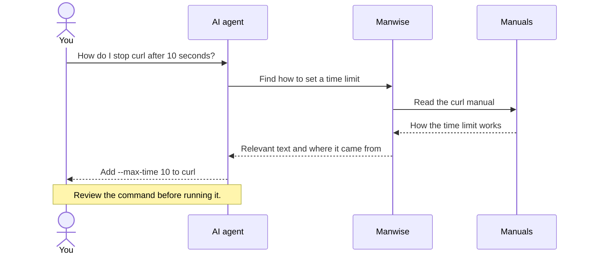

# Manwise

Manwise helps AI agents read the manuals on your computer. They can check how a
command works before suggesting what you should run, even when they cannot use
your terminal.

It returns the relevant text and names the manual it came from.



Manwise reads the manual. It does not run the command the agent suggests.

## Build and connect

Use macOS or Linux. Install the tools needed to build Manwise:

**macOS**, if Apple's developer tools are not already installed:

```sh
xcode-select --install
```

**Debian or Ubuntu:**

```sh
sudo apt-get install build-essential man-db manpages
```

For C programming manuals, also install `manpages-dev`.
On other versions of Linux, install the matching build and manual tools.

Open a terminal in the Manwise folder and build the program:

```sh
make
```

Print the settings for your AI app:

```sh
./build/manwise client-config
```

Copy the printed `manwise` entry into your AI app's **MCP settings**, where you
add tools, then reconnect. Your app starts Manwise for you.

If the app asks how to connect, choose **stdio**. Copy the **command** and
**args** values exactly as printed.

## Try it with your AI agent

> Use Manwise to check how to stop a curl request after ten seconds.
> Show me the relevant part of the manual.

The answer should name the manual and explain what to do. Compare it with
`man curl` on the same computer. You can also ask:

- Find manuals about file permissions.
- Look up how curl saves a download to a file.
- Explain printf using its C manual.

For regular use, add this instruction to your project's agent guide:

> When unsure how a command works, use Manwise to check its manual. Name the
> manual you used, and check that it matches the program and computer we are
> working on.

## Which manuals can it read?

The manuals come from the computer running Manwise. Check that they describe
the version of the program you are using.

If a search finds nothing, ask for a manual by name. The list of searchable
manuals may be missing or out of date.

To use a particular folder of manuals, replace the example below with that
folder's full path:

```sh
./build/manwise client-config --manpath /absolute/path/to/share/man
```

Repeat `--manpath` for each folder you want to use. Only those folders will
be searched.

Manwise relies on your computer's tools for reading manuals. Use tools and
manual files you trust.

## Tests

With Python 3.9 or later installed, run the tests:

```sh
make test
```

To check for memory errors, you also need the Clang C compiler:

```sh
make sanitize
```

See the [contributor guide](AGENTS.md#checks) for more checks.
To understand how Manwise works, read the [code](src/c/) and [tests](tests/).

[MIT license](LICENSE). cJSON has its own [license](vendor/cjson/LICENSE).
